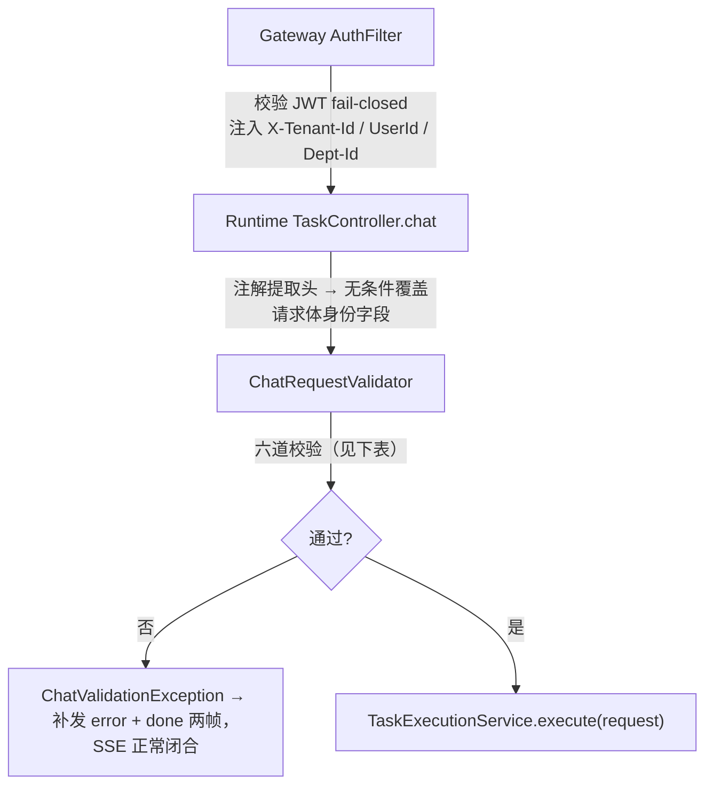
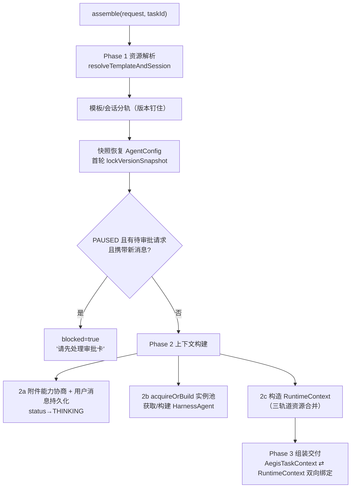
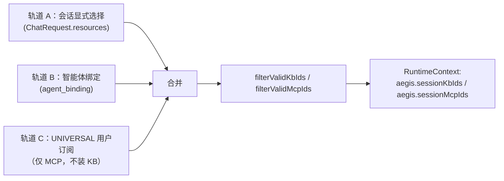
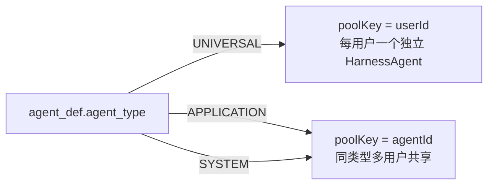
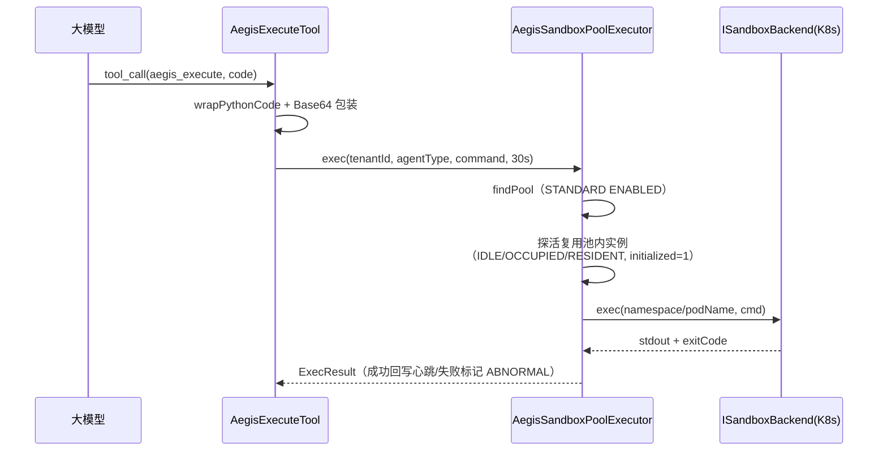
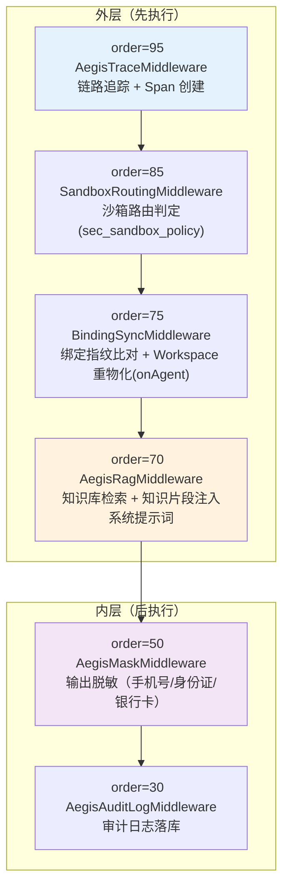
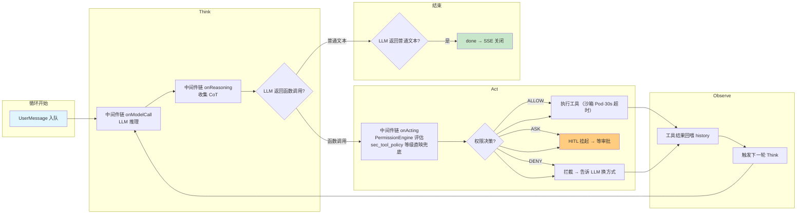
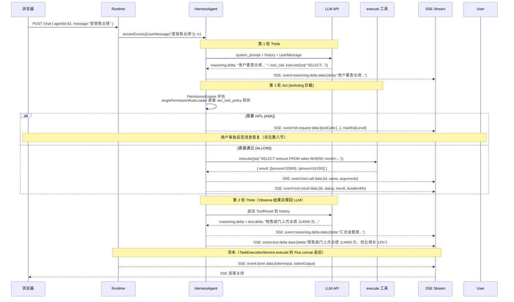
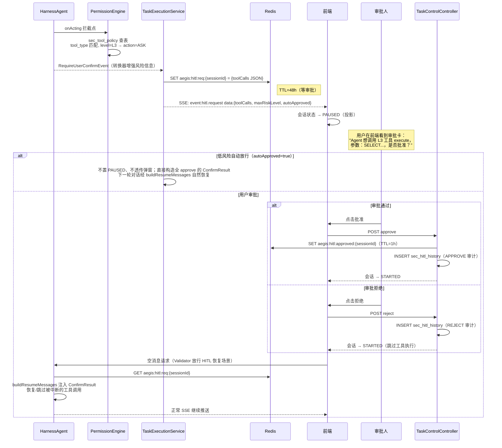
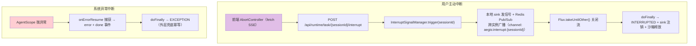

# 运行时全流程剖析

> 适用版本：0.1.0-alpha.1 ｜ 最后更新：2026-09-08（逐文件源码复核：TaskController / ChatRequestValidator / TaskExecutionService / AgentAssemblyService / SessionProjectionService / HarnessEventConverter / SessionManageService / AegisAgentInstanceManager / InterruptSignalManager / HitlFlowService）

---

## 序章：全局一瞥

从用户浏览器发起 SSE 连接到 Agent 返回最终回复，一共经过 6 个阶段、2 个进程（gateway → runtime）、6 个中间件、N 次 ReAct 循环。

### 一句话链路

```
浏览器 → Gateway（鉴权 + 注入租户头）→ Runtime（六道校验 → 装配 → 流式执行 → 事件转换 → 投影持久化）→ AgentScope 内核（ReAct 循环 + 洋葱链中间件 + LLM + 工具调用 + 安全拦截 + HITL）→ SSE 流式回传
```

### 阶段划分

```
┌──────────────────────────────────────────────────────────────────────────────┐
│  阶段 1: 入口校验     │  阶段 2: 智能体装配    │  阶段 3: AgentScope 构建      │
│  TaskController +    │  AgentAssemblyService  │  AegisAgentInstanceManager    │
│  ChatRequestValidator│  → AegisTaskContext    │  → HarnessAgent.Builder      │
└──────────────────────────────────────────────────────────────────────────────┘
                                    ↓
┌──────────────────────────────────────────────────────────────────────────────┐
│  阶段 4: 洋葱链中间件  │  阶段 5: ReAct 循环（Think→Act→Observe）│  阶段 6: 投影持久化 │
│  6 层中间件           │  agent.streamEvents(msgs, rc)           │  SessionProjectionSvc │
└──────────────────────────────────────────────────────────────────────────────┘
```

---

## 一、入口：ChatRequest 进 Runtime

### 输入：HTTP 请求

```http
POST /api/runtime/task/chat
Content-Type: application/json
Accept: text/event-stream

// Gateway 自动注入的头（用户请求里没有；Controller 用 @TenantId/@UserId/@DeptId
// 注解提取后**无条件覆盖**请求体同名字段，杜绝客户端伪造身份）
X-Tenant-Id: 1
X-User-Id: 1001
X-Dept-Id: 50
X-Client-IP: 10.0.0.5
Authorization: Bearer eyJhbGci...

// 用户请求体（ChatRequest DTO，@Valid 校验）
{
  "agentId": 42,
  "sessionId": null,              // null = 创建新会话（UUID32）
  "message": "帮我查一下上个月销售部门的业绩报表",
  "attachments": [
    { "fileId": "att-9f21", "name": "报表模板.xlsx", "sizeKB": 148 }
  ],
  "skills": [],                   // @技能名 显式引用，为空=用绑定的技能
  "resources": { "kbIds": [1], "mcpIds": [] },  // 会话级临时资源引用
  "replyId": "req-uuid-abc123",   // 客户端重试去重用
  "isolationStrategy": null       // null = SHARED_PER_SCOPE（默认）
}
```

### 处理链路



### ChatRequestValidator 六道校验（来自 `ChatRequestValidator.java`，源码核实）

| # | 校验项 | 规则 | 失败错误码 |
|---|---|---|---|
| 1 | 参数完整性 | agentId 必填；message 仅**新会话**必填（有 sessionId 即 HITL 恢复场景，允许空消息） | PARAM_ERROR |
| 2 | 身份合法性 | tenantId / userId 必须 > 0（fail-closed） | UNAUTHORIZED |
| 3 | 附件快速校验 | 数量 ≤ 10 个、单文件 ≤ 50MB（纯内存）；归属校验按 (fileId, tenantId, userId) 精确匹配，失败二次查询区分「不存在 / 跨租户跨用户越权」（IDOR 防护） | ATTACHMENT_* |
| 4 | 用户状态 | 禁用用户拒绝（Caffeine 缓存 60s，admin 禁用后最长 60s 生效） | FORBIDDEN |
| 5 | 并发互斥 | 同会话已有活跃 SSE 流时拒绝；**三重放行**：无活跃 sink / DB 会话已非活跃态 / 心跳超 30s 未更新（先清理僵尸 sink 再判定） | CONFLICT（recoverable=true） |
| 6 | replyId 去重 | Redis SETNX `reply:t{tenantId}:{sessionId|new}:{replyId}`（TTL 5min）；Redis 不可用时**降级放行**不阻断 | DUPLICATE_REQUEST |

> **注意**：智能体生命周期校验（PUBLISHED 等）不在此层——由装配阶段 `AgentAssemblyService.checkLifeStatus` 承担（见第二节）；sessionId 的租户/用户归属校验在 `SessionManageService.getOrCreateSession`（越权抛 SecurityException）。

校验失败不中断 SSE 连接：`TaskController.onErrorResume(ChatValidationException)` 补发 `error` + `done` 两帧，保证前端 EventSource 正常闭合。

除 `/chat` 外，同一入口还提供：`/regenerate`（重生成）、`/edit`（编辑重发）、`/sync`（非流式聚合）、`/history`、`/sessions` 等端点（见 `TaskController.java`）。

---

## 二、智能体装配：AgentAssemblyService.assemble()

装配是**同步阻塞**操作，在 `boundedElastic` 线程池执行（整体由 `TenantContextScope.bound(tenantId)` 包裹，保证 MyBatis-Plus 租户插件可见租户）。按「三相结构」组织：

### 装配流程（三相结构）



### Phase 1：版本钉住（P1-2 B 方案）与快照恢复

| 场景 | 解析顺序 | 说明 |
|---|---|---|
| **新会话**（无 sessionId） | 模板先行（最新版）→ 生命周期校验 → 建会话 → 首轮锁定快照 | 先校验后建会话，避免为不可用智能体产生孤儿会话记录 |
| **老会话** | 会话先行 → 按 `session.agentVersion` 钉住版本加载模板 | 进行中会话不随后续发布漂移；config / bindings / 版本标签严格同源 |

- **生命周期校验**（`checkLifeStatus`）：PUBLISHED 所有人可用；DRAFT / REJECTED 仅作者本人自用调试（旁路放行）；REVIEWING / ARCHIVED / null 一律拒绝（blocked）。
- **快照恢复**：`session.versionSnapshot` 非空时从中恢复 AgentConfig（systemPrompt / modelTier / temperature / maxTurns / enabledTools），优先于模板当前配置。
- **HITL 保护**：会话 PAUSED 且 Redis 有待审批请求时，携带新消息的请求直接 blocked——否则消息持久化会把 PAUSED 覆盖为 THINKING，内核抛 paused 异常 → 外层 doFinally 强制 EXCEPTION，审批卡永久失效。

### Phase 2a：附件能力协商与用户消息持久化

- `ModelCapabilityResolver` 按模型能力为每个附件决定策略（ENGINE_PARSE 解析入文 / NATIVE_PASS 图片直传等），`ContentAdapter` 按模型上下文窗口智能裁剪合并文本（替代一刀切硬截断）。
- NATIVE_PASS 图片：MinIO 读字节 → 缩放 → Base64 → `ImageBlock`（多模态）。
- `persistUserMessage`（fire-and-forget，3 次重试）+ 会话状态 → THINKING。

### Phase 2c：RuntimeContext 与三轨道资源合并



> v3 语义：知识库必须**显式指定**（轨道 A/B），UNIVERSAL 智能体的轨道 C 只自动装载订阅 MCP——保证「用户不指定知识库 = 纯 LLM + 工具」的预期行为。

### Phase 2b：实例池（poolKey + 绑定指纹）



实例池命中时通过 `BindingFingerprinter`（SHA-256，输入 = agentVersion + bindings + 动态部分）比对指纹：

- **一致** → 读锁复用实例（冷启动 500-2000ms → **<50ms**）
- **不一致** → 先以 stale 工具响应本轮请求，再**异步** `refreshToolkit`（移除旧工具重注册 + Workspace 重物化）

poolKey 同时参与 agentVersion 隔离（新老版本实例互不复用）。

### AegisTaskContext 结构（装配输出）

```java
AegisTaskContext {
    String taskId                    // UUID32，全链路 traceId
    Long tenantId, userId
    Long agentId
    AgentDef agentDef                // 不可变骨架
    AgentConfig agentConfig          // 快照恢复后的运行配置（本轮不变）
    String sessionId                 // 会话 ID
    HarnessAgent agent               // AgentScope 内核实例
    RuntimeContext runtimeContext    // AgentScope 运行时上下文（双向绑定）
    String userMessage               // 附件协商并入后的用户文本
    List<ContentBlock> multimodalBlocks // NATIVE_PASS 图片块
    boolean blocked                  // 装配失败标记
    String blockReason               // 失败原因
}
```

---

## 三、AgentScope HarnessAgent 构建

AegisAgentInstanceManager 是 AgentScope 内核和 Aegis 业务层的桥。

### Builder 链式构建（来自 `AegisAgentInstanceManager.configureAgentBuilder()`，源码核实）

```java
HarnessAgent.builder()
    .name("AegisAgent-" + agentId)
    .sysPrompt(effectiveSysPrompt)                       // 快照恢复后的系统提示词
    .model("aegis:" + modelTier.toLowerCase() + ":" + tenantId)  // AegisModelProvider 按 ID 路由
    .toolkit(toolkit)                                    // AegisSkillRepository 装载的 Toolkit
    .distributedStore(distributedStore)                  // Redis 实现
    .disableFilesystemTools()                            // 禁用 AS 内置文件工具
    .disableShellTool()                                  // 禁用内置 Shell，强制走 aegis_execute
    .skillRepository(skillRepository)
    .skillsEnabled(true)
    .maxIters(agentConfig.maxTurns != null ? maxTurns : aegis.upon.max-iters)  // 默认 5
    .agentId(String.valueOf(agentId))
    .middlewares(standaloneMiddlewares)                  // 6 层中间件链
    .compaction(...) .toolResultEviction(...)
    .maxRetries(3).maxContextTokens(100_000)
    .permissionContext(permissionContext)                // sec_tool_policy 运行时权限
    .filesystem(remoteFsSpec / sandboxFsSpec)           // RemoteFS 或沙箱 FS
    .build();
```

### 隔离作用域（IsolationScope）与 Redis Key

> AgentScope 把**对话上下文（AgentState）**与**沙箱隔离（slotKey）**拆成两个独立维度，别混为一谈。

**① AgentState（对话上下文）Redis Key**——由 `AegisRedisConfig` 的 Redis AgentState Store（keyPrefix=`aegis:session:`）管理，格式固定、与治理档无关：

| Key | 类型 | 说明 |
|---|---|---|
| `aegis:session:{userId}/{sessionId}:agent_state` | String(JSON) | 单值对话上下文（运行时主链路，调用前后读写） |
| `aegis:session:{userId}/{sessionId}:agent_state:list` | List | 上下文历史 |
| `aegis:session:{userId}/{sessionId}:_keys` | Set | 本会话全部 Redis Key 索引（删主 key 须连带清） |

**② 沙箱隔离**——工作区走 `RemoteFilesystemSpec` + IsolationScope（`USER`/`AGENT`），代码执行走 `AegisSandboxPoolExecutor` 池化复用（详见 [sandbox-allocation-and-recycling.md](sandbox-allocation-and-recycling.md)）：

| agent_type | IsolationScope | 语义 |
|---|---|---|
| UNIVERSAL | USER | 同一用户跨会话共享工作区 |
| APPLICATION | AGENT | 同一智能体跨会话共享 |
| SYSTEM | AGENT | 对外 API 场景（RESIDENT 常驻实例，**实例状态**而非 IsolationScope 枚举值） |

### 代码执行沙箱池路径（aegis_execute）



---

## 四、中间件链（6 层）

AgentScope 2.0.2 的 Middleware 有 **5 个拦截点**：4 个**洋葱型**（`onAgent` / `onReasoning` / `onActing` / `onModelCall`）+ 1 个**管道型变换**（`onSystemPrompt`）。order 值越大越外层、越先执行，对 4 个洋葱型统一生效；`onSystemPrompt` 按 order 排序后串联改写系统提示词。

### order 值（各中间件 `order()` 方法，经 Spring 注入 `List<MiddlewareBase>` 排序装配）



### 洋葱链在 5 个拦截点分别做什么

| 拦截点 | 类型 / 触发时机 | 主要中间件 | 做什么 |
|---|---|---|---|
| **onAgent** | 洋葱·最外层，进入 Agent 时 | TraceMiddleware(95) + BindingSyncMiddleware(75) | 创建 Agent Span，开启链路追踪；绑定指纹比对 + Workspace 重物化 |
| **onSystemPrompt** | 管道·发给 LLM 之前 | RagMiddleware(70) | RAG 知识片段注入系统提示词（含【重要约束】） |
| **onModelCall** | 洋葱·每次调 LLM 时 | TraceMiddleware(95) | 创建 MODEL_CALL Span 记录 I/O |
| **onReasoning** | 洋葱·LLM 返回 CoT 时 | TraceMiddleware(95) | 创建 REASONING / tool_call Span |
| **onActing** | 洋葱·LLM 决定调工具时 | TraceMiddleware(95) · SandboxRouting(85) · Audit(30) + AgentScope PermissionEngine | 沙箱路由判定；工具权限评估；审计落库 |

安全决策不在中间件链内，由 AgentScope 原生 `PermissionEngine` 在 `onActing` 承担，规则经 `AegisPermissionRuleLoader` 从 `sec_tool_policy` 装载（未配置时等级直映兜底：L1/L2→ALLOW，L3→ASK，L4→DENY）。

---

## 五、ReAct 循环：Think → Act → Observe

一个完整对话可能经过 1-N 轮循环，由 `TaskExecutionService.streamExecution` 驱动。

### 流式执行 Flux 管道（源码核实，顺序敏感）

```java
agent.streamEvents(msgs, rc)                                  // 主流：AgentScope 内核驱动 ReAct
    .onBackpressureBuffer(256, BufferOverflowStrategy.DROP_OLDEST)   // 背压：丢最旧事件
    .timeout(Duration.ofMinutes(5))                           // 无事件超时终止
    .retryWhen(Retry.backoff(2, Duration.ofMillis(1500))       // 仅网络类异常重试
        .filter(this::isNetworkError))
    .takeUntilOther(interruptSink.asFlux())                    // 用户中断（本地 sink + Redis Pub/Sub 跨实例）
    .concatMap(evt -> convertMany(evt) → processConvertedEvent(...))  // 切 boundedElastic，同会话保序
    .doOnNext(evt -> { 累积 output/reasoning/token; 心跳 touch; })
    .filter(evt -> !"task.status".equals(evt.getEvent()))      // 内部统计事件不上行前端
    .doFinally(signal -> { HITL PAUSED 竞态保护; onTerminate 投影; unregister; 沙箱释放; })
```

**消息构造**：HITL 恢复消息（`buildResumeMessages`，优先注入）+ 用户消息（`UserMessage`，含图片时为 TextBlock + ImageBlock 多模态块）。

**内存累积器**（落库原料，流中逐事件累积）：

- `outputBuffer` ← text.delta 拼接（正式回复）
- `reasoningBuffer` ← reasoning.delta 拼接（思考过程）
- `tokenStats` [input, output] ← task.status（MODEL_CALL_END 转换）累计

### 循环结构



### 每轮循环的事件序列（SSE 输出）

以一个典型的两轮对话为例（查销售业绩 → 调用 execute 执行 SQL → 返回结果）：



---

## 六、SSE 事件协议

AgentScope `AgentEvent` 经 `HarnessEventConverter` 转换为 Aegis `AgentEvent`（DTO：event / data / timestamp），再由 `TaskController.toServerSentEvent` 序列化推送。事件名与 data 结构与前端 `src/types/session.ts` 契约对齐。

> **帧格式注意**：SSE 帧的 `data` 是**双层 JSON**——整个 AgentEvent 序列化（外层含 `event` 与 `data` 字段，内层才是业务 data）：
>
> ```
> event: text.delta
> data: {"event":"text.delta","data":{"delta":"销售部门","replyId":"r-9f21"}}
> ```
>
> （字段顺序不构成契约。）

### 事件类型字典（HarnessEventConverter 映射，源码核实）

| AgentScope 事件 | Aegis 事件 | 触发时机 | data 字段 |
|---|---|---|---|
| —（TaskExecutionService 构造） | `agent_start` | 装配完成、流首 | `{taskId, sessionId, agentId, agentName, agentVersion, model, resourceCount, timestamp}` |
| TEXT_BLOCK_DELTA | `text.delta` | LLM 流式输出文本片段 | `{delta, replyId}` |
| THINKING_BLOCK_DELTA | `reasoning.delta` | LLM CoT 思考过程片段 | `{delta, replyId}` |
| TOOL_CALL_START | `tool.call` | 工具调用发起 | `{id, name, arguments}`（参数占位空对象，由 DELTA 累积后在 tool.result 补全） |
| TOOL_CALL_DELTA / TOOL_RESULT_TEXT_DELTA / TOOL_RESULT_DATA_DELTA | **（累积，不输出）** | 参数/结果增量 | 累积后供 tool.result 使用 |
| TOOL_RESULT_END | `tool.result` | 工具执行完成 | `{id, replyId, name, status, result, arguments, durationMs, dataBlocks}` |
| REQUIRE_USER_CONFIRM | `hitl.request` | 安全策略 ASK 时 | `{replyId, toolCalls[{id,name,input,riskInfo{riskLevel,riskReason,category,toolType,needApproval,sandboxExecution}}], maxRiskLevel, autoApproved}` |
| CUSTOM | 按名字透传（如 `kb.reference`） | 中间件发自定义事件 | RAG：`{replyId, refs, query, kbCount}`（refs 含 kbId/kbName/docId/docName/chunkIndex/content/score/scoreType） |
| SUBAGENT_EXPOSED | `subagent.start` | 子智能体启动 | `{subagentId, agentId, sessionId, label, timestamp}` |
| （子代理）AGENT_END | `subagent.end` | 子智能体结束 | `{subagentId, agentId, replyId, status, durationMs, summary}` |
| MODEL_CALL_END | `task.status`（内部） | 每次模型调用结束 | `{tokenInput, tokenOutput, tokenTotal, durationMs}`——**被 filter 过滤不上行前端**，仅用于 token 统计 |
| （主）AGENT_END | `done` | 智能体完成回复 | `{replyId}` |
| —（TaskExecutionService 流末追加） | `done` | Flux.concat 追加的关闭信号 | `{}`（两帧均被注入 tokenInput/tokenOutput 统计） |
| —（SkillRepository 解析 @技能） | `skill.activated` / `skill.rejected` | 用户显式 @技能时 | `{skills:[...], timestamp}` / `{skills:[...], reason, timestamp}` |
| —（异常路径） | `error` | 执行异常 | `{code, message, detail, timestamp, recoverable?}` |
| AGENT_START / *_BLOCK_START / EXCEED_MAX_ITERS / ALL_TOOLS_DENIED 等 | **null（跳过）** | 前端不需要的中间事件 | — |

> **勘误说明（2026-09-08 源码复核）**：① 主 Agent 的 `AGENT_END` 经转换器映射为 **`done`**——运行时**不存在** `agent_end` 事件（`SessionProjectionService` 中的 agent_end 处理分支为防御性代码，实际不触发，终态 ENDED 由 `onTerminate` 的 ON_COMPLETE 信号设置）；② 前端每轮收到**两个 `done` 帧**：转换器发出的（携带 replyId）+ `TaskExecutionService.execute` 流末追加的（追加位置在 execute 的 Flux.concat，非 TaskController）；③ 文本增量事件名为 **`text.delta`**（此前文档误作 `message.delta`）；④ 消息序号 Redis key 实际为 `aegis:tenant:{tenantId}:msg:seq:{sessionId}`（见第七节）。

### 完整 SSE 帧示例（raw text，两轮 ReAct · 一次工具调用）

```yaml
# 帧 1: agent_start（TaskExecutionService 构造）
event: agent_start
data: {"event":"agent_start","data":{"taskId":"a3f1c8...","sessionId":"5f3aa2e8...","agentId":42,"agentName":"销售助手","model":"STANDARD","resourceCount":2,"timestamp":1757308800000}}

# 帧 2: kb.reference（AegisRagMiddleware 发出，CUSTOM 透传）
event: kb.reference
data: {"event":"kb.reference","data":{"replyId":"r-9f21","query":"上月销售部门业绩","kbCount":1,"refs":[{"id":"kb-ref-1-101-0","kbId":1,"kbName":"架构文档库","docId":101,"docName":"2026H1报表.pdf","chunkIndex":0,"content":"...","score":0.612,"scoreType":"similarity"}]}}

# 帧 3: reasoning.delta（CoT 思考）
event: reasoning.delta
data: {"event":"reasoning.delta","data":{"delta":"用户要查的是上月销售部门业绩，我需要执行 SQL 查询...","replyId":"r-9f21"}}

# 帧 4-5: 工具调用（Act）
event: tool.call
data: {"event":"tool.call","data":{"id":"tc-01","name":"aegis_execute","arguments":{}}}
event: tool.result
data: {"event":"tool.result","data":{"id":"tc-01","replyId":"r-9f21","name":"aegis_execute","status":"SUCCESS","result":"[{\"SUM(amount)\":114000}]","arguments":{"code":"SELECT SUM(amount) FROM sales WHERE month='2026-08'"},"durationMs":1240}}

# 帧 6: reasoning.delta（第二轮思考）
event: reasoning.delta
data: {"event":"reasoning.delta","data":{"delta":"查询结果是 114000 元...","replyId":"r-9f21"}}

# 帧 7-9: text.delta（流式文本输出，可能拆多帧）
event: text.delta
data: {"event":"text.delta","data":{"delta":"销售部门","replyId":"r-9f21"}}
event: text.delta
data: {"event":"text.delta","data":{"delta":"上月业绩 114,000 元","replyId":"r-9f21"}}
event: text.delta
data: {"event":"text.delta","data":{"delta":"，同比增长 12%","replyId":"r-9f21"}}

# 帧 10-11: 双 done（AGENT_END 转换 + 流末追加，均注入 token 统计）
event: done
data: {"event":"done","data":{"replyId":"r-9f21","tokenInput":1836,"tokenOutput":412}}
event: done
data: {"event":"done","data":{"tokenInput":1836,"tokenOutput":412}}
```

---

## 七、投影持久化：SessionProjectionService

**流式输出过程中 fire-and-forget 落库，不阻塞 SSE 主线程。** 所有写入走 `SessionManageService`（内部 3 次重试、间隔 100ms），失败仅记日志。事件回调运行在 AgentScope 内核线程（跨租户复用），因此 `onEvent` / `onTerminate` 均以 `TenantContextScope.of(tenantId)` **恢复式作用域**包裹（绑定 + 离开时恢复）。

### 运行时数据状态：两套会话记忆并存（关键）

| 存储 | Key / 表 | 性质 | 读写时机 | 用途 |
|---|---|---|---|---|
| Redis（AgentScope） | `aegis:session:{userId}/{sessionId}:agent_state` | **运行时上下文（主链路必落）** | 调用开始 `GET` 重载、调用结束 `SET` 落盘 | ReAct 循环的对话缓冲，分布式部署取到最新状态 |
| MySQL（Aegis） | `sess_message` / `sess_session` | **审计/回放投影（异步可降级）** | 流式 fire-and-forget | 消息留痕、状态机、前端历史查询 |

> `agent_state` 为运行态（丢失则本轮对话断片），`sess_message` 为审计 / 回放投影；`deleteSession` 级联清 MySQL 并删 AgentScope Redis key。

### 消息序号（seq）：Redis Lua 原子自增（C7）

```lua
-- key = aegis:tenant:{tenantId}:msg:seq:{sessionId}
-- ARGV[1] = DB 当前 MAX(seq)（仅首次初始化使用）
if redis.call('exists', KEYS[1]) == 0 then redis.call('set', KEYS[1], ARGV[1]) end
return redis.call('incr', KEYS[1])
```

- SETNX 初始化 + INCR 合并为**单次原子操作**，消除竞态覆盖窗口；热路径 key 已存在时纯 INCR，零 DB 读。
- Redis 不可用时降级 DB `MAX(seq)+1`（单实例正确，跨实例可能冲突；唯一索引作 DB 兜底安全网保留）。
- 同会话串行（`concatMap` 保序），seq 单调递增——前端 `beforeSeq` 分页依赖连续性。

### 状态流转（statusCache 去重，避免数百次冗余 UPDATE）

```mermaid
stateDiagram-v2
    [*] --> STARTED: 创建 sess_session
    STARTED --> THINKING: 装配期 persistIncomingMessage
    THINKING --> TOOL_CALLING: tool.call 事件
    TOOL_CALLING --> TOOL_CALLING: 多工具调用场景可循环
    TOOL_CALLING --> OUTPUTTING: tool.result / text.delta / reasoning.delta 事件
    OUTPUTTING --> THINKING: 新一轮 ReAct
    OUTPUTTING --> PAUSED: hitl.request 事件（用户审批中）
    PAUSED --> THINKING: 审批通过，恢复执行
    OUTPUTTING --> ENDED: 流 ON_COMPLETE（onTerminate）
    * --> INTERRUPTED: 用户中断 / SSE 连接断开（CANCEL）
    * --> EXCEPTION: 执行异常（ON_ERROR）

    note right of PAUSED
        PAUSED/ENDED 为保护态：
        onTerminate 不覆盖
    end
```

### 事件驱动落库

| 事件 | 触发落库 | 写入表 |
|---|---|---|
| 装配期（用户消息） | persistUserMessage（fire-and-forget·3 次重试） | sess_message（USER） |
| `tool.call` | persistToolCallMessage | sess_message（TOOL_CALL） |
| `tool.result` | persistToolResultMessage | sess_message（TOOL_RESULT） |
| `text.delta` / `reasoning.delta` | 不直接落（累积到终态一次落） | — |
| `hitl.request` | 会话 → PAUSED（doFinally 竞态保护：已审批则跳过） | sess_session + Redis（审批审计见第八节） |
| 流终止（onTerminate） | persistAssistantMessage（content + reasoning + token 双列）+ 终态（ON_COMPLETE→ENDED / CANCEL→INTERRUPTED / ON_ERROR→EXCEPTION） | sess_message（ASSISTANT）+ sess_session |
| `generate_file` 工具 | sess_artifact INSERT + MinIO PUT | sess_artifact, MinIO |

### 双层 doFinally 兜底（会话永不卡死）

- **内层**（streamExecution.doFinally）：HITL PAUSED 竞态保护 → `onTerminate` 投影 → sink 注销（registerId 精确匹配）→ 沙箱释放（HITL 暂停时保留沙箱待恢复）。
- **外层**（execute.doFinally）：CANCEL/ERROR 时 `forceUnregister` + `onForceTerminate`（`terminateIfActive` 仅对活跃态生效，幂等不覆盖已正确设置的终态）+ 沙箱兜底释放——保证异常分支（如 assemble 抛错）会话必然进入终态。

### 成本：当前只落 token，不计算金额（实现缺口）

- `sess_message.token_input` / `token_output`、`sess_session.token_used`、`mon_trace.token_input` / `token_output` 来自 LLM 回传的 `ChatUsage`，**真实落库**；
- `sess_message.cost_amount` / `mon_trace.cost_amount` 字段存在，但 `aegis-runtime` 内**无任何代码计算或赋值**（grep `costAmount` 零命中），运行时恒为 `NULL`；
- `model_def.input_cost` / `output_cost`（元/千 token）仅 Admin 模型管理配置，runtime 不参与计费。

> 若需真实金额，应在 `onTerminate` 处用 `ChatUsage × ModelDef 单价` 补算（当前未接线）。

---

## 八、HITL 审批流（完整闭环）

当 AgentScope PermissionEngine 评估工具策略为 ASK 时触发（规则由 `AegisPermissionRuleLoader` 从 sec_tool_policy 装载）。会话进入 PAUSED 状态，等待用户审批。

### 全流程时序



### 要点（源码核实）

- **风险信息增强**：`hitl.request` 的 toolCalls 每项带 `riskInfo{riskLevel, riskReason, category, toolType, needApproval, sandboxExecution}`——内置工具查 `BuiltinToolRiskConfig`，外部工具（MCP）查 `res_tool` 表，未知工具默认高风险兜底。
- **低风险自动放行**：全部工具 needApproval=false 时 `autoApproved=true`——不弹审批卡、不置 PAUSED，直接构造全 approve 的 ConfirmResult，下一轮对话自然恢复（避免低风险工具打扰用户）。
- **审计落库时机**：`sec_hitl_history` 在**审批动作发生时**由 `TaskControlController.writeHitlHistory` 写入（操作人/动作/时间/详情）；HITL 触发时仅写 Redis。
- **竞态保护**：流结束（doFinally）与用户审批并发时——若审批端点已将会话置回 STARTED（已审批），跳过 PAUSED 覆盖；恢复流消费 ConfirmResult 后 `clearHitlState` 清理 Redis，避免污染下一轮。
- **HITL 暂停保护**：PAUSED 且有 pending 请求时，携带新消息的请求在装配层直接 blocked（见第二节）。

---

## 九、网络重试与异常处理

### Retry 策略（来自 `TaskExecutionService.java`）

```java
MAX_NETWORK_RETRIES = 2
RETRY_DELAY_MS = 1500  // backoff 起步，指数退避
```

只对**网络类异常**重试：ConnectException / SocketTimeoutException / UnknownHostException / UnresolvedAddressException / TimeoutException（含异常链遍历 + 消息关键词匹配）。业务异常（比如 PermissionDeniedException）不重试。

### 异常分类处理

| 异常类型 | 处理方式 |
|---|---|
| 网络类（LLM API 连接超时/DNS 解析失败） | 重试 2 次 → 耗尽后返回 `error` 事件（SERVICE_UNAVAILABLE / GATEWAY_TIMEOUT，recoverable=true） |
| 业务类（BusinessException） | 不重试 → 按 ResultCode 映射用户友好文案（QUOTA_EXCEEDED / CONFLICT / HITL_PENDING 等） |
| HITL paused 异常（SDK） | 映射 HITL_PENDING，提示先处理审批卡 |
| 流式中断（用户关闭页面） | `doFinally` 兜底 → `forceUnregister` + `onForceTerminate` → INTERRUPTED |
| SSE Buffer 溢出 | `onBackpressureBuffer(256, DROP_OLDEST)` → 丢弃最旧事件 |

---

## 十、中断与控制流

### 两种中断方式



### 心跳与僵尸 sink 清理

- 每个事件 `doOnNext` 都 `touchHeartbeat`（registerId 精确匹配，避免误删新请求的 sink）；
- 后台清理器按 60s 超时阈值周期清理僵尸 sink（`aegis.runtime.interrupt.heartbeat-timeout-seconds=60`）；
- 并发校验时心跳超 30s 视为卡死，强制清理后放行新请求——避免「上次断连导致本次永远 CONFLICT」。

---

## 附录：完整事件序列速查

以一个最典型的对话（两轮 ReAct，一次 execute 工具调用）为例：

| # | SSE 事件 | 来源 | 持久化动作 |
|---|---|---|---|
| 1 | `agent_start` | TaskExecutionService 装配完成后构造 | —（装配期已落 USER 消息，状态 THINKING） |
| 2 | `kb.reference` | AegisRagMiddleware（CUSTOM 透传） | —（引用随 ASSISTANT 终态落库） |
| 3 | `reasoning.delta` ×N | LLM ReAct 第 1 轮（THINKING_BLOCK_DELTA） | —（累积到 reasoningBuffer） |
| 4 | `tool.call` | TOOL_CALL_START 转换 | sess_message INSERT（TOOL_CALL）+ 状态 TOOL_CALLING |
| 5 | `tool.result` | TOOL_RESULT_END 转换（含累积参数/结果/时长） | sess_message INSERT（TOOL_RESULT） |
| 6 | `reasoning.delta` ×N | LLM ReAct 第 2 轮 | — |
| 7 | `text.delta` ×N | LLM 流式输出（TEXT_BLOCK_DELTA） | —（累积到 outputBuffer） |
| 8 | `done`（转换器） | AGENT_END 转换（携带 replyId） | — |
| 9 | `done`（流末） | TaskExecutionService.execute 的 Flux.concat 追加 | 流 ON_COMPLETE → onTerminate：sess_message INSERT（ASSISTANT：content+reasoning+token）+ 状态 ENDED |

如果中间触发 HITL，在 tool.call 之后插入 `hitl.request` → 会话 PAUSED → 用户审批（sec_hitl_history 审计）→ 空消息恢复 → 后续事件照常。

---

## 附录：Redis Key 全景

| Key Pattern | 谁写谁读 | TTL | 用途 |
|---|---|---|---|
| `aegis:session:{userId}/{sessionId}:agent_state` | AgentScope 内核自动读写 | 会话存活期 | AgentState 序列化（单值） |
| `aegis:session:{userId}/{sessionId}:agent_state:list` | AgentScope 内核 | 会话存活期 | AgentState 历史（列表） |
| `aegis:session:{userId}/{sessionId}:_keys` | AgentScope 内核 | 会话存活期 | 会话内所有 Key 的索引 |
| `aegis:store:item:{userId}/{sessionId}\0{filename}` | AgentScope Workspace | 会话存活期 | Workspace 文件内容 |
| `aegis:store:idx:{userId}/{sessionId}` | AgentScope Workspace | 会话存活期 | Workspace 文件索引 |
| `aegis:tenant:{tenantId}:msg:seq:{sessionId}` | SessionManageService 读写（Lua 原子） | 会话存活期 | 消息序号自增（**key 含租户段**，2026-09-08 勘误修正） |
| `aegis:hitl:req:{sessionId}` | TaskExecutionService 写（触发时），恢复时读 | **48h** | 工具调用原始请求 JSON |
| `aegis:hitl:approved:{sessionId}` | 审批通过时写，恢复时读 | **1h** | 审批标记 |
| `aegis:security:policy:{tenantId}:{policyType}` | SecurityCache 读，Admin 通知时失效 | 30min | 安全策略 JSON 缓存（policyType: TOOL/CONTENT/MASK/OUTBOUND/HITL） |
| `reply:t{tenantId}:{sessionId|new}:{replyId}` | ChatRequestValidator 写（SETNX），重试请求检查 | 5min | 客户端重试去重 |
| `aegis:rate_limit:{scopeType}:{scopeId}:{window}` | RateLimitService 读写 | 窗口级 | 限流 ZSET 计数器 |
| `aegis:interrupt:{sessionId}`（channel） | InterruptSignalManager 发布/订阅 | — | 跨实例中断广播 |

---

## 附录：涉及的核心 Service/类速查

| 类名 | 职责 | 在哪一步 |
|---|---|---|
| `TaskController` | HTTP 入口，注解提取租户头，SSE 帧序列化（event 名 + AgentEvent JSON 双层 data） | 阶段 1 |
| `ChatRequestValidator` | 六道校验（参数/身份/附件/用户状态/并发互斥/replyId 去重） | 阶段 1 |
| `TaskExecutionService` | 编排：装配 → 流式执行（背压/超时/重试/中断）→ 事件转换分发 → 双层 doFinally 兜底 | 阶段 2+5+6 |
| `AgentAssemblyService` | 三相装配：模板/会话分轨（版本钉住）→ 消息持久化/实例获取/RuntimeContext（三轨道资源合并） | 阶段 2 |
| `AegisAgentInstanceManager` | 实例池管理（poolKey + 绑定指纹懒刷新）+ HarnessAgent.Builder 装配 + RemoteFS | 阶段 3 |
| `List<MiddlewareBase>` | Spring 注入按 order() 排序的 6 层中间件 → Builder.middlewares() | 阶段 3 |
| `AegisSkillRepository` | 按档位分轨装载 Toolkit（技能/MCP/知识库） | 阶段 2+3 |
| `AegisPermissionRuleLoader` | sec_tool_policy → PermissionRule 装载给 AgentScope PermissionEngine | onActing 拦截点 |
| `HitlFlowService` | Redis 存审批请求（saveHitlRequest/markApproved）→ 恢复时注入 ConfirmResult | onActing + 恢复 |
| `TaskControlController` | 审批端点（approve/reject）+ sec_hitl_history 审计写入 + 中断端点 | HITL/中断 |
| `HarnessEventConverter` | AgentScope 事件 → Aegis 事件（本文档第六节映射表的唯一真相源） | 阶段 5 |
| `SessionProjectionService` | fire-and-forget 投影：工具消息落库 + 状态流转（statusCache 去重）+ 终态设置 | 流式中 + 终态 |
| `SessionManageService` | 会话/消息持久化（seq Redis Lua 原子自增）+ 历史查询 + 重生成/编辑 | 阶段 2+6 |
| `InterruptSignalManager` | register（registerId 精确清理）→ sink → trigger + Redis Pub/Sub 跨实例 + 心跳超时清理 | 流式中 |
| `AgentPoolManager` | LRU + TTL 实例池驱逐（Caffeine 双缓存：模板 + 版本） | AegisAgentInstanceManager 内部 |
